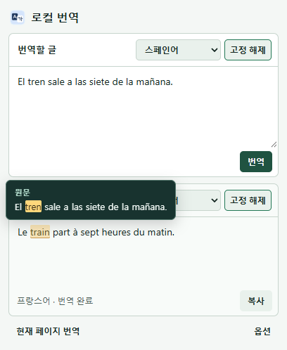
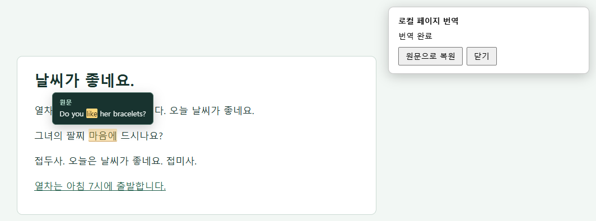
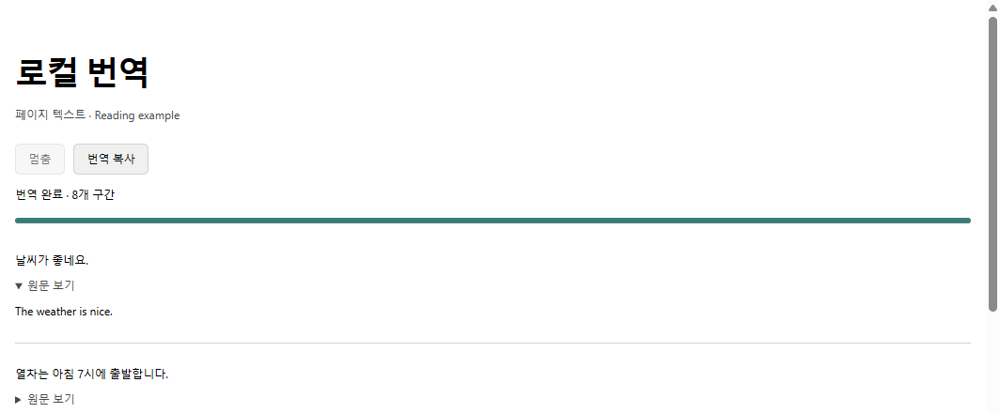

# 로컬 번역 v1.1 · Chrome 확장 프로그램

Google Chrome에서 웹페이지, 선택한 텍스트, 직접 입력한 문장을 번역합니다. 한 번 모델을 받아 두면 PFN의 **PLaMo 3 Translate 0.8B GGUF Q4_K_M**이 PC의 Vulkan GPU에서 번역을 처리합니다.

[Windows x64 빌드 ZIP 다운로드](downloads/Local-Translator-v1.1-Windows-x64.zip?raw=true) · [번역 예제 페이지](https://dsw1357.github.io/local-translator/)

## 툴바에서 바로 번역

툴바에 고정한 확장 아이콘을 눌러 위 칸에 글을 입력합니다. 아래 칸에 번역이 표시됩니다. 원문은 **자동 감지**할 수 있고, 원문과 번역 언어 모두 [지원 언어 목록](https://huggingface.co/pfnet/plamo-3-translate-0.8b-GGUF#supported-languages)에서 선택할 수 있습니다. 자주 쓰는 언어는 각 목록의 **고정** 버튼으로 맨 위에 둡니다.

번역문에서 단어 위에 마우스를 올리면 원문 문장이 열립니다. 모델이 대응 표현을 찾으면 양쪽 단어가 함께 강조됩니다. **옵션 → 원문 미리보기**에서 단어 강조를 켜거나 끌 수 있습니다.

## 웹페이지에서 번역

문장을 드래그해 우클릭하면 **선택한 텍스트를 한국어로 번역** 메뉴가 나옵니다. 페이지 전체는 **페이지를 한국어로 번역** 메뉴나 팝업 하단의 **현재 페이지 번역**으로 번역합니다.

기본값인 **페이지 내 번역**은 링크와 HTML 구조를 유지하면서 보이는 텍스트를 바꿉니다. **원문으로 복원**을 눌러 되돌릴 수 있습니다.

기본 40,000자 한도에 도달하면 진행 창에 **남은 페이지 번역**이 표시됩니다. 누르면 앞서 번역한 부분을 원문으로 되돌리고, 아직 번역하지 않은 부분을 같은 페이지에서 번역합니다. 모델이 길이 제한을 반환한 문장은 더 작은 구간으로 나누어 재시도합니다. 다음 구간에서 바뀐 번역이 없으면 직전 번역을 유지합니다.

[번역 예제 페이지](https://dsw1357.github.io/local-translator/)에서 **장문 예제**를 고르고 페이지를 번역해 보세요. 기본 40,000자 설정에서는 한도에 도달하면 **남은 페이지 번역**이 나타납니다. **뒷부분으로 이동**을 눌러 이어서 번역한 문단을 확인할 수 있습니다.

## 새 탭에 번역 결과 모으기

**옵션 → 번역 표시 방식 → 번역 시 새 탭 열기**를 선택하면 결과를 별도 탭에 모읍니다. 각 문장의 **원문 보기**, 번역문 복사, 진행 중 멈춤을 사용할 수 있습니다.

## Chrome에 설치

1. Windows x64에서 [빌드 ZIP](downloads/Local-Translator-v1.1-Windows-x64.zip?raw=true)을 풀고 `BUILD.cmd`를 실행합니다. 공식 Vulkan 런타임과 모델을 내려받아 SHA-256을 확인하고 `extension` 폴더를 만듭니다. 첫 빌드에 약 610MB를 내려받습니다.
2. Chrome 주소창에서 `chrome://extensions`를 엽니다. **개발자 모드**를 켜고 **압축해제된 확장 프로그램 로드**에서 생성된 `extension` 폴더를 고릅니다.
3. `START.cmd`를 실행합니다. Chrome의 확장 프로그램 메뉴에서 **우클릭 로컬 번역**을 고정하면 툴바에서 바로 열 수 있습니다. 엔진을 종료할 때는 `STOP.cmd`를 실행합니다.

Chrome 매니페스트의 최소 버전은 116입니다. 최신 데스크톱 Chrome에서 사용을 권장합니다. Brave Origin은 `brave://extensions`, 네이버 웨일은 `whale://extensions`에서 같은 빌드를 로드할 수 있습니다.

기존 설치를 업데이트할 때는 엔진을 종료하고 기존 폴더에 새 빌드 파일을 덮어씁니다. `BUILD.cmd`를 실행한 뒤 확장 관리 화면에서 **새로고침**을 누르고 `START.cmd`를 실행합니다.

## 실행 환경

- **GPU**는 Vulkan을 지원하는 Windows x64 드라이버가 필요합니다. GPU는 자동 선택되며, `START.cmd -Device Vulkan1`처럼 직접 지정할 수 있습니다.
- **로컬 처리**에 쓰는 엔진 주소는 `127.0.0.1:39781`입니다. 모델 다운로드 후 번역할 때는 인터넷 연결이 필요하지 않습니다.
- **번역 길이**에서 한 번에 번역할 페이지 글자 수를 40,000~200,000자로 지정할 수 있습니다.
- **모델 컨텍스트**는 기본 8,192토큰, 16,384토큰, 최대 32,768토큰 중 선택합니다. 기본 엔진은 2슬롯으로 요청당 4,096토큰을 사용하고, 확장 설정은 1슬롯을 사용합니다. 옵션에서 시작 명령을 복사한 뒤 `STOP.cmd`로 엔진을 종료하고 해당 명령으로 실행하세요.

STOP.cmd

START.cmd -ContextTokens 32768

컨텍스트에는 모델로 보낸 원문과 생성한 번역문이 모두 포함됩니다.

[변경 이력](CHANGELOG.md) · [Chrome 직접 설치 안내](https://developer.chrome.com/docs/extensions/get-started/tutorial/hello-world#load-unpacked) · [PLaMo 모델 및 라이선스](https://huggingface.co/pfnet/plamo-3-translate-0.8b-GGUF) · [llama.cpp Vulkan 배포본](https://github.com/ggml-org/llama.cpp/releases/tag/b12246)
